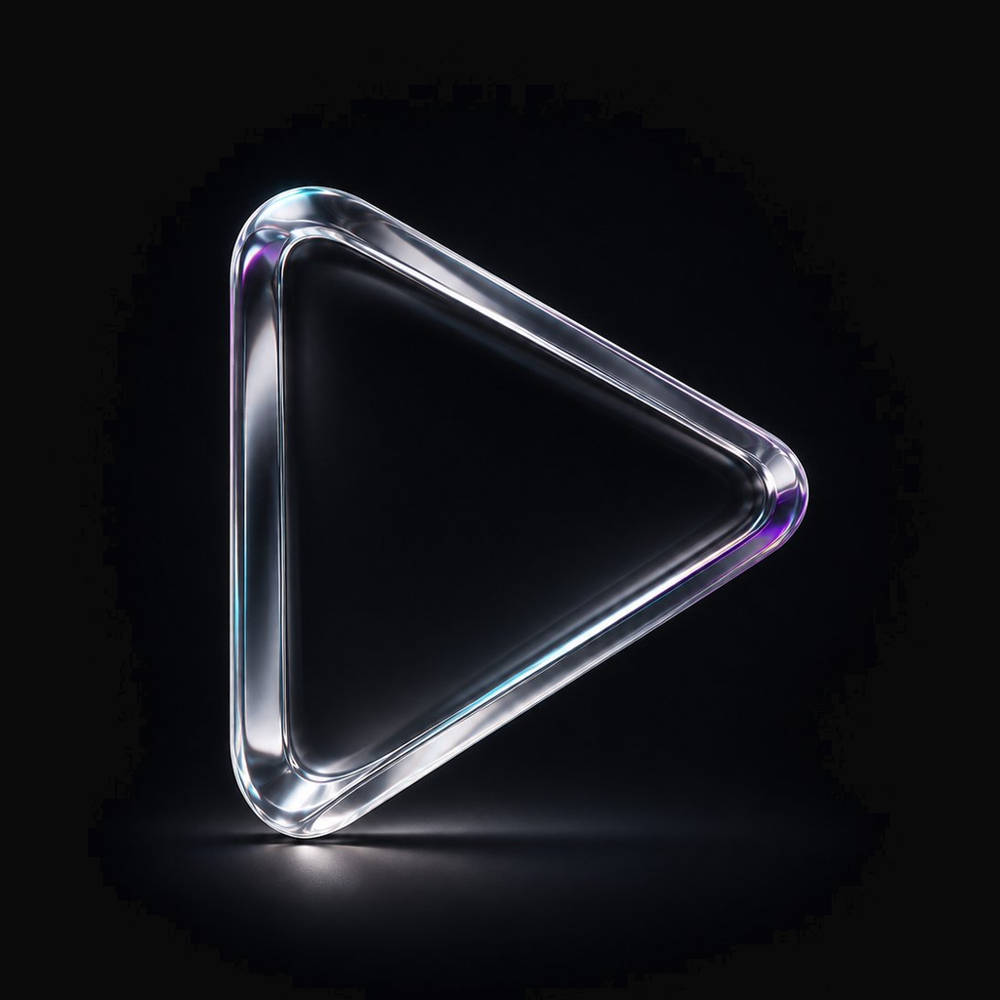
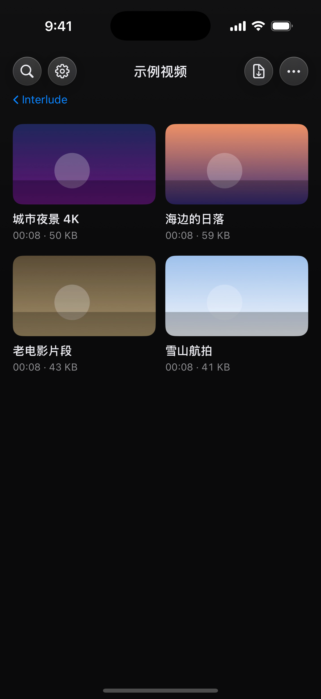
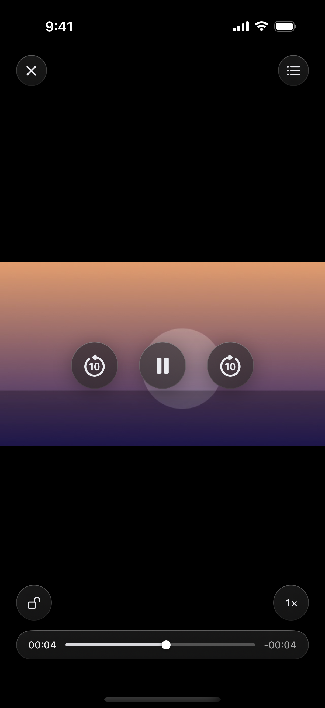
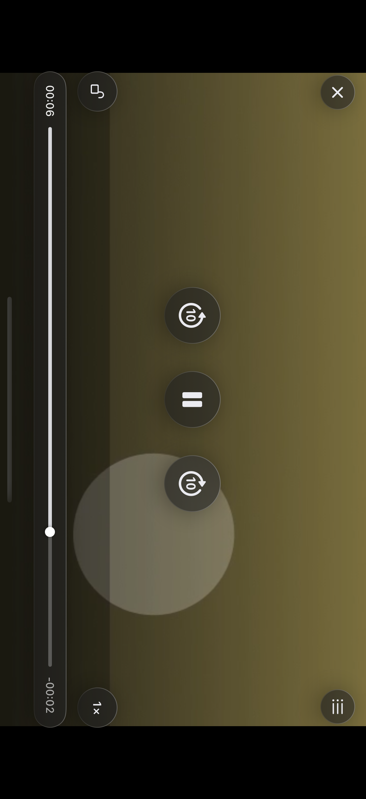

# 幕间 · Interlude

<p align="center">
  
</p>

**一个人的 iOS 本地视频播放器。SwiftUI + AVPlayer，零第三方依赖，不联网、不登录、不上传。**


视频只存在 App 的 `Documents` 目录里。没有账号体系、没有统计埋点、没有任何服务器——源码里搜不到一个网络请求。

| | |
|---|---|
| 📥 [下载安装包](#-安装) | Releases 里的未签名 ipa，Sideloadly / 爱思助手自签 |
| 🛠 [从源码构建](#-从源码构建) | 有 Mac 用 XcodeGen；没 Mac 用 GitHub Actions 白嫖编译 |
| 📸 [界面截图](#-界面) | 每次构建自动截到 [`ci-shots`](https://github.com/loinz-Max/localplayer/tree/ci-shots) 分支 |
| 📋 [开发与交接文档](#-文档) | 交接 / 设计规格 / 验收记录都在 `docs/` |

> 工程名与仓库名是 `LocalPlayer`，bundle id 是 `com.loinzmax.localplayer`——改名只动桌面显示名，不动这些，覆盖安装才能保住数据。

---

## ✨ 功能

### 资料库

- 文件 App / 相册 / 访达文件共享三种导入，**后台导入**带进度胶囊，导完汇总说明
- 文件夹浏览、新建、重命名（只改显示名不动磁盘）、删除（有确认）
- 顶栏搜索：跨整个资料库按文件名找，结果标出所在文件夹
- 长按视频：标记已看、重命名（真改磁盘文件名，**进度与已看标记随之迁移**）、移到文件夹、删除
- 缩略图取「时长 12%、不早于 3 秒」那一帧——自动避开片头台标和广告

### 播放

- 断点续播；播放模式：列表循环 / 单集循环 / 播完暂停（播完自动标已看）
- **播完自动下一集**：设置开关（默认关），追剧模式
- **画中画**：播放页一键进系统小窗；小窗「展开」带进度回到播放页，「关闭」则暂停收尾
- 倍速五档直选 + 长按倍速（1.5–3× 可配）；画面比例适应 / 填充 / 拉伸
- 手势：横滑调进度（带目标帧预览）、左滑亮度右滑音量、长按加速、双击 ±10 秒、双指捏合切比例
- 防误触锁、控件自动隐藏可调、屏幕常亮、退出播放页自动恢复亮度

### 系统集成

- **锁屏 / 控制中心 / AirPods / 车机「正在播放」**：封面、进度条、±10 秒、拖进度、切集
- 来电打断后自动续播，拔耳机自动暂停
- 后台音频：切出去声音继续

### 观感细节

- 自定义四层液态玻璃控件体系（`.ultraThinMaterial` + 染色 + 描边 + 投影）
- **转屏幕布**：进出播放页的方向旋转发生在黑幕后面，配「竖屏观看 / 横屏观看」小动画——只在真的会转屏时出现
- 冷启动棱镜 logo 一闪（约 1 秒），灯亮之前的一瞬，不是开屏广告

---

## 📱 界面

截图来自 **GitHub Actions 真机模拟器实拍**（每次 push 自动重拍，见 [`ci-shots`](https://github.com/loinz-Max/localplayer/tree/ci-shots) 分支）：

| 资料库 | 播放页 | 横屏播放 |
|:---:|:---:|:---:|
|  |  |  |

更多场景（搜索 / 播放列表 / 设置页 / 长按菜单）也在 `ci-shots` 分支里。

---

## 📥 安装

仓库 Release 提供未签名 ipa（当前 [v0.0.6 直链](https://github.com/loinz-Max/localplayer/releases/download/v0.0.6/LocalPlayer-0.0.6-unsigned.ipa)，2.10 MB）。ipa 未签名，装到真机需要自签：

**Windows（爱思助手 / Sideloadly）**

1. 下载 ipa → 爱思助手「应用 → 导入 ipa」或 [Sideloadly](https://sideloadly.io) 拖入，填 Apple ID 签名
2. iPhone「设置 → 通用 → VPN 与设备管理」信任证书；iOS 16+ 开「开发者模式」并重启
3. 免费证书 **7 天**有效，到期重新签一次**覆盖安装**——数据不丢

**⚠️ 天花板（提前讲清）**

- 免费账号同时最多 3 个自签名 App
- **卸载 = `Documents` 里的视频一起没**。换证书 / 重装时只能覆盖安装，不能先卸；重要片子先在「文件」App 里留一份
- 换图标后 iOS 会缓存旧图标，重启手机即可，别卸载重装

> ⚠️ 本仓库不是 App Store 分发，也不提供任何可绕过签名的途径。签名环节全部依赖你自己的 Apple ID 与系统机制。

---

## 🛠 从源码构建

### 方式 A：有 Mac

```bash
brew install xcodegen
xcodegen generate
open LocalPlayer.xcodeproj    # 选自己的 iPhone，⌘R
```

或一键编译 + 装进模拟器 + 带示例视频启动：`bash scripts/dev.sh`。
增删 Swift 文件后要重新 `xcodegen generate`。

### 方式 B：没有 Mac（本仓库当前的方式）

推送 `main` 自动触发 [`ios-ipa.yml`](.github/workflows/ios-ipa.yml)，两个 job：

| job | 产出 |
|---|---|
| 模拟器截图 | `simulator-screenshots` artifact + 推送 `ci-shots` 分支 |
| 打包未签名 ipa | `LocalPlayer-unsigned-ipa` artifact |

Fork 之后第一次跑：Settings → Actions → General → **Workflow permissions 选 Read and write**，否则截图推送那步会失败。

---

## 📚 文档

| 文档 | 内容 |
|---|---|
| [`docs/HANDOVER.md`](docs/HANDOVER.md) | ★ **开发交接文档**：当前进度、迭代记录（0.0.1–0.0.6 逐轮）、待办（P0–P4）、踩坑清单、接手指南 |
| [`docs/DESIGN.md`](docs/DESIGN.md) | 视觉与交互规格：色板、玻璃配方、每页布局、设计决策表 |
| [`docs/ACCEPTANCE-2026-11-13.md`](docs/ACCEPTANCE-2026-11-13.md) | 0.0.3 真机验收记录（11 项全过） |
| [`docs/ACCEPTANCE-2026-11-12.md`](docs/ACCEPTANCE-2026-11-12.md) | 0.0.1 那轮的验收存档 |
| [`CHANGELOG.md`](CHANGELOG.md) | 逐版本更新记录 |
| `preview/` | 早期 HTML 界面原型（**已落后于实现，以代码为准**） |

**想接手 / 继续开发？从 [`docs/HANDOVER.md`](docs/HANDOVER.md) 开始**——10 分钟读完，包含完整的上下文与下一步计划。

---

## 🗂 目录结构

```
localplayer/
├─ README.md                        本文件
├─ LICENSE                          MIT
├─ CHANGELOG.md                     逐版本更新记录
├─ project.yml                      XcodeGen 工程描述（部署目标 iOS 17.0）
├─ Info.plist                       桌面名、文件共享、后台音频、方向声明
├─ .github/workflows/ios-ipa.yml    云端编译 + 模拟器截图
├─ docs/                            交接 / 设计 / 验收文档（见上表）
├─ preview/                         早期 HTML 原型（存档）
├─ scripts/
│  ├─ dev.sh                        本地一键：生成工程 → 编译 → 装机 → 带数据启动
│  ├─ gh-helper.js                  CI 状态 / artifact 下载的命令行小工具
│  ├─ publish-ipa.js                把 ipa 发布到 GitHub Release
│  └─ push-api.js                   git 被代理挡住时改用 Git Data API 推送
└─ LocalPlayer/                     29 个 Swift 文件 · 约 6,500 行 · 零第三方依赖
   ├─ App/LocalPlayerApp.swift      入口，注入 store，配 AVAudioSession
   ├─ Models/VideoItem.swift        VideoItem / SortKey / PlayMode
   ├─ Player/
   │  ├─ PlayerModel.swift          AVPlayer 封装：时间轴 / 倍速 / 缓冲 / 失败态
   │  └─ VideoSurface.swift         AVPlayerLayer 的 SwiftUI 包装
   ├─ Services/
   │  ├─ AppSettings.swift          所有设置项（键名集中在此）
   │  ├─ LibraryStore.swift         扫描、导入、删除、重命名、建文件夹、目录监听
   │  ├─ ImportService.swift        后台导入：copy / move + 进度与结果汇总
   │  ├─ ProgressStore.swift        进度 + 最近播放顺序 + 已看标记
   │  ├─ NowPlayingService.swift    锁屏 / 控制中心 / AirPods 遥控、打断恢复
   │  └─ ThumbnailLoader.swift      缩略图与时长缓存（NSCache + 并发去重）
   ├─ Support/
   │  ├─ Palette.swift              色板（所有颜色值集中在此）
   │  ├─ Glass.swift                ★ 四层玻璃配方 + 圆键
   │  ├─ HUD.swift                  ★ 统一轻提示胶囊 + 导入进度
   │  ├─ OrientationController.swift 方向策略：非播放页竖屏，播放页按设置
   │  ├─ OrientationCurtain.swift   ★ 转屏幕布：转屏发生在黑幕后面
   │  ├─ PiPService.swift           ★ 画中画：接管 / 展开 / 关闭的生命周期
   │  ├─ LaunchFlash.swift          冷启动品牌一闪
   │  ├─ ScreenBrightness.swift     亮度（进播放页记录、退出恢复）
   │  ├─ SystemVolume.swift         系统音量（隐藏 MPVolumeView）
   │  ├─ ScrubPreviewer.swift       拖动进度的抓帧预览（0.5 秒一档 + 节流）
   │  ├─ Formatters.swift           体积 / 时间格式化、重名去重
   │  └─ DebugSeed.swift            仅 Debug：示例视频、截图直达参数
   └─ Views/
      ├─ LibraryView.swift          资料库页（网格 + 长按 + 弹窗 + 导入）
      ├─ LibraryMenus.swift         导入 / 更多 / 长按菜单 / 移动弹窗
      ├─ Cards.swift                视频卡片 / 文件夹卡片 / 角标 / 缩略图
      ├─ PlayerScreen.swift         播放页（顶栏 + 三圆 + 进度条 + 手势 + 浮层）
      ├─ PlayerPanels.swift         播放列表抽屉 / 倍速浮层
      ├─ PhotoPickerSheet.swift     PHPicker 封装（拿原文件名，不需要相册权限）
      └─ SettingsView.swift         四级设置页
```

---

## 🧭 继续开发前值得知道的几件事

- **玻璃配方**在 `Support/Glass.swift`：`.ultraThinMaterial` → 渐变染色 → 0.75pt 上亮下暗描边 → 外投影；四套预设 `.control` / `.panel` / `.stage` / `.hud`。用法 `.glass(Circle())` 或 `.glass(cornerRadius: 20, style: .panel)`。
- **纯黑底上玻璃永远是黑的**：没有内容可透，染色调得再透也看不出层次。资料库背景顶部特意压了一层 2.8% 白雾（`LibraryView.backgroundLayer`），别当成没用的一行删掉。染色调低时必须同步加亮描边，否则控件边界会散。
- **方向策略**：`OrientationController` 让非播放页锁竖屏、播放页按设置转。`requestGeometryUpdate` 必须丢到下一个 runloop 才生效；播放页用同层 `.overlay` 呈现而非 fullScreenCover（modal 会绕过 AppDelegate 的方向掩码）。
- **画中画的命门**：AVPlayer 挂在一个 6×6 的常驻宿主视图上（key window、几乎全透明），全屏页退出后图层仍在层级里，小窗才不会被掐断；播放页 `teardown()` 靠 `PiPService.isTakingOver(_:)` 判断是否跳过清理，否则 `replaceCurrentItem` 一调用小窗立刻黑屏。
- **轻提示只有一套**：`Support/HUD.swift` 的 `HUDLabel`，toast / 长按倍速 / 拖动预览的时间标签都用它。
- **画中画必须 `import AVKit`**——`AVPictureInPictureController` 不在 AVFoundation 里；用了 `@Published` 的类要显式声明 `ObservableObject`。
- 刻意**没用** iOS 26 的 `glassEffect`：需要 Xcode 26 工具链，CI 跑在 `macos-15` 上不稳；自定义 Material 玻璃在 iOS 17 起全部可用。
- **配色**在 `Palette.swift`，与 `preview/ui-v3.html` 的 `:root` 对应。
- 播放页的倍速与模式存在 `PlayerScreen` 这一层，切集不丢、退出即丢——这是设计，不是 bug。
- 模拟器不支持画中画，CI 截图里永远看不到画中画按钮——别误判为漏做。

<details>
<summary><strong>🔧 调试启动参数（仅 Debug 生效，点开）</strong></summary>

写在 `Support/DebugSeed.swift`，用 `xcrun simctl launch <udid> <bundle-id> <参数>` 传：

| 参数 | 作用 |
|---|---|
| `-screen home\|folder\|player\|settings\|empty` | 启动后直达某一屏 |
| `-screen foldermenu` | 直达首页并弹出第一个文件夹的长按菜单 |
| `-screen move` | 直达首页并弹出「移到文件夹」弹窗 |
| `-panel queue\|speed\|lock\|level\|boost` | 进播放页后直接展开列表抽屉 / 倍速浮层 / 锁定态 / 亮度条 / 长按倍速提示 |
| `-seedDemo 1` | 现场生成 8 段 8 秒示例视频 |
| `-keepChrome 1` | 钉住播放控制栏，截图拍得到 |
| `-landscape 1` | 真的把 App 转到横屏 |

> 模拟器 `simctl io screenshot` 只拍竖屏 buffer，横屏截图里控件是侧躺的——截屏方式的问题，不是布局问题。

</details>

<details>
<summary><strong>💾 数据与状态（点开）</strong></summary>

| 数据 | 存哪 | 说明 |
|---|---|---|
| 视频文件 | `Documents/` | 相对路径即稳定 ID（`VideoItem.id`） |
| 播放进度 | UserDefaults `progress.snapshot.v1` | `positions` / `totals` / `lastPlayed` / `order` / `watched` |
| 文件夹显示名 | UserDefaults `folder.displayNames.v1` | 只影响界面，磁盘目录名不变 |
| 设置 | UserDefaults | 键名集中在 `AppSettings.Key` |
| 缩略图 | 内存 NSCache | 失败退 3 秒 → 首帧 → 占位图标 |

视频重命名与「移到文件夹」会迁移进度与已看标记（ID 随路径变化）；删除视频或文件夹会一并清掉记录。

</details>

---

## 🚧 已知边界（有意为之）

1. **MKV / AVI 等容器播不了**。AVPlayer 是系统解码器，这是刻意的取舍——画中画、AirPlay、HDR 在 AVPlayer 上零成本，换 mpv 就要重建整条渲染管线。真要换，只需替换 `PlayerModel` 与 `VideoSurface` 两处，UI 层一行不用动。
2. **`ts` / `m2ts` 不当作可播**。AVPlayer 只在 HLS 分片里认 MPEG-TS。
3. **不做字幕、不做音轨切换**。AVPlayer 对内封字幕基本无解，做出来是「有的能用有的不能用」。
4. **不做局域网传输**。访达文件共享或「文件」App 拖拽即可，Documents 本来就是系统可见目录，App 内再起 HTTP 服务器反而弄脏「不联网」的承诺。
5. 相册导入拿到的是**导出版本**（相册里做过的剪辑会生效），iCloud「优化存储」的原片需先下载。
6. 排序只露「最近播放 / 名称」两档——两档够用，四档全露是噪音。

---

## 📄 License

[MIT](LICENSE) © 2026 loinz-Max

**幕间**——两幕之间的黑场，灯暗一下，换一场。
